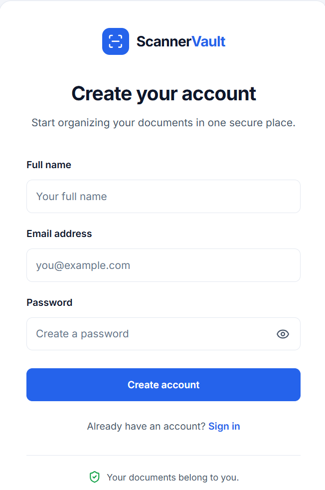
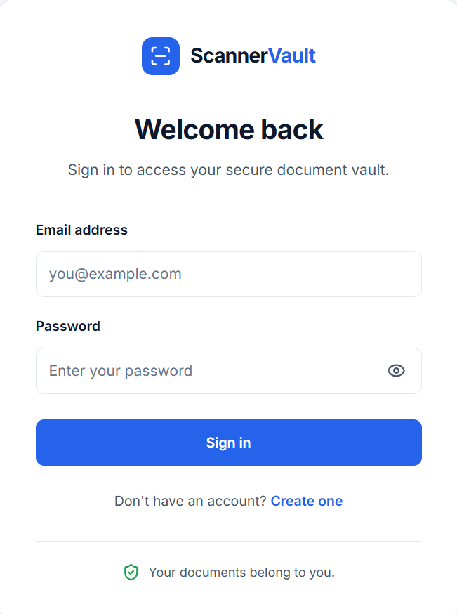
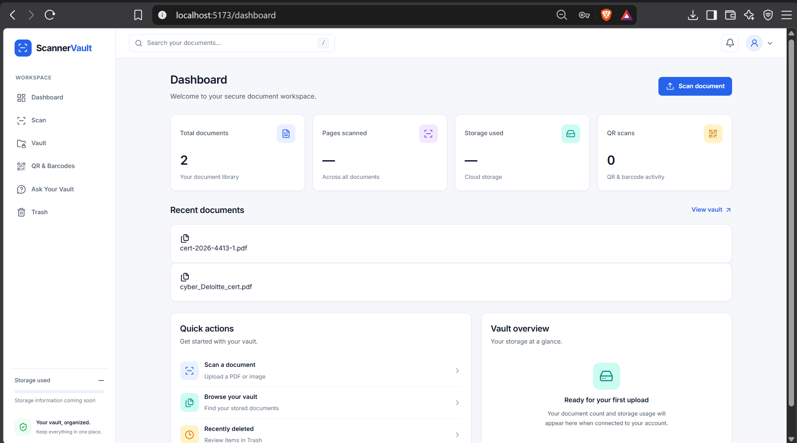
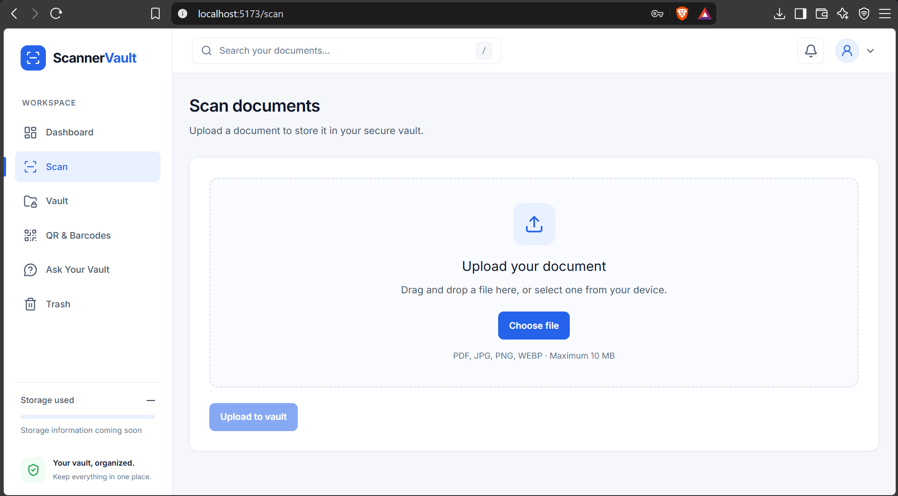
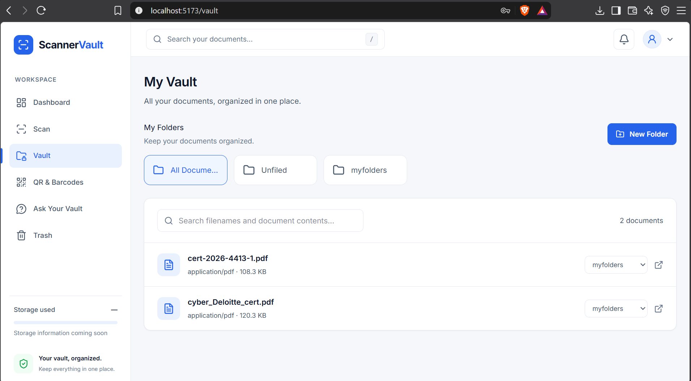
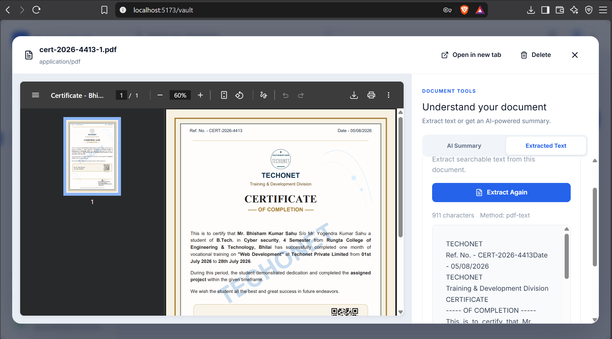
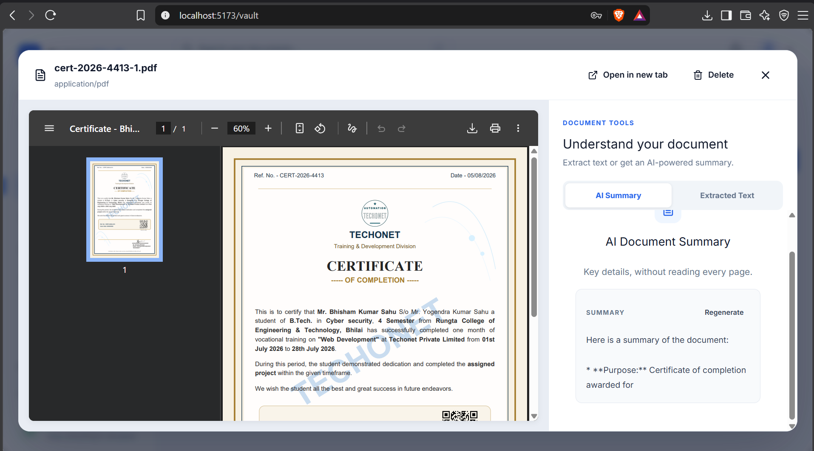
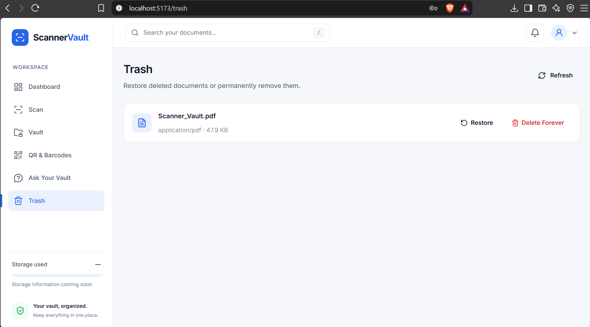

# 🔐 Scanner Vault

### Smart Document Scanning, Secure File Management & AI-Powered Insights

Scanner Vault is a full-stack web application designed to simplify document scanning, digital file management, OCR-based text extraction, and AI-powered document summarization through a unified interface.

The project aims to make managing digital documents easier by combining document organization, intelligent text processing, and secure file management in one platform.

---

## 📑 Table of Contents

- [About the Project](#-about-the-project)
- [Features](#-features)
- [Upcoming Features](#-upcoming-features)
- [Tech Stack](#-tech-stack)
- [Project Screenshots](#-project-screenshots)
- [Project Structure](#-project-structure)
- [Getting Started](#-getting-started)
- [Environment Configuration](#-environment-configuration)
- [Future Improvements](#-future-improvements)
- [Author](#-author)

---

## 🎯 About the Project

Scanner Vault is being developed as a centralized platform for working with digital documents.

It provides a user interface for authentication, document scanning, file organization, OCR text extraction, AI-assisted summaries, and trash management.

The application follows a full-stack architecture with a React frontend, a Node.js and Express backend, and MongoDB for data storage.

The goal is to build a convenient and extensible document management platform with intelligent features.

---

## ✨ Features

### 🔑 User Authentication
- User registration interface.
- Login interface.
- Protected routes for restricted application pages.

### 📊 Dashboard
- Central dashboard for navigating the application.
- Quick access to the main features.

### 📄 Document Scanning
- Dedicated scanning interface for document-related operations.

### 🗂️ My Vault
- Dedicated interface for accessing and organizing stored documents.

### 🔍 OCR Text Extraction
- Interface for extracting and viewing text from supported documents or images.

### 🤖 AI-Powered Summaries
- AI-assisted summarization of supported content.

### 🗑️ Trash & Restore
- Interface for managing deleted items and restoring supported files.

*Note: The availability of each feature depends on the current implementation and configuration of the application.*

---

## 🚧 Upcoming Features

The following features are planned for future releases and are not yet available in the current version.

### 📱 QR & Barcodes

A planned feature to scan and process QR codes and barcodes, making it easier to access encoded information.

**Planned capabilities:**
- QR code scanning and decoding.
- Barcode detection and decoding.
- Displaying decoded information within the application.

### 💬 Ask Your Vault

An AI-powered document assistant planned to help users interact with their stored documents using natural-language questions.

**Planned capabilities:**
- Ask questions about stored documents.
- Retrieve relevant information from document content.
- Generate AI-assisted answers based on available documents.

*These capabilities are planned and should not be considered implemented until they are available in the application.*

---

## 🛠️ Tech Stack

### Frontend
- React.js
- Vite
- JavaScript
- React Router
- CSS

### Backend
- Node.js
- Express.js
- JavaScript

### Database
- MongoDB
- Mongoose, if used in the project

### Development Tools
- Visual Studio Code
- Git
- GitHub
- npm

### Additional Technologies
OCR libraries, AI services, authentication libraries, and file-processing tools may be used depending on the actual implementation.

*Only list additional technologies that are actually present in the source code.*

---

## 📸 Project Screenshots

Here are the screenshots of the current Scanner Vault interface.

### 1. Registration Page

The interface for new users to register.



### 2. Login Page

The login interface for existing users.



### 3. Dashboard

The main dashboard for navigating application features.



### 4. Document Scanning

The interface for document scanning operations.



### 5. My Vault

The interface for accessing and managing stored documents.



### 6. OCR Text Extraction

The interface for working with extracted document text.



### 7. AI Summary

The interface for AI-assisted content summarization.



### 8. Trash & Restore

The interface for managing deleted items and restoring supported files.



---

## 📁 Project Structure

The main project structure is organized into frontend, backend, and screenshot directories.

```text
Scanner_Vault/
├── backend/
│   ├── src/
│   ├── package.json
│   └── .env
├── frontend/
│   ├── src/
│   ├── public/
│   └── package.json
├── screenshots/
│   ├── 01-registration.png
│   ├── 02-login.png
│   ├── 03-dashboard.png
│   ├── 04-scanning.png
│   ├── 05-my_vault.png
│   ├── 06-OCR_extraction.png
│   ├── 07-AI_summary.png
│   └── 08-Trash_Restore.png
├── .gitignore
└── README.md
```

*This is an illustrative structure. Your actual source files and directories may differ.*

---

## 🚀 Getting Started

Follow these steps to set up Scanner Vault on your local machine.

### Prerequisites

Make sure you have installed:

- [Node.js](https://nodejs.org/)
- npm (included with Node.js)
- [Git](https://git-scm.com/)
- MongoDB locally or a MongoDB Atlas account

### 1. Clone the Repository

```bash
git clone YOUR_GITHUB_REPOSITORY_URL
cd Scanner_Vault
```

Replace `YOUR_GITHUB_REPOSITORY_URL` with the actual URL of your GitHub repository.

### 2. Install Backend Dependencies

```bash
cd backend
npm install
```

### 3. Configure Backend Environment Variables

Create a `.env` file in the backend directory and add the environment variables required by your application.

For example, if these names match your backend configuration:

```env
PORT=5000
MONGO_URI=your_mongodb_connection_string
```

Your application may require additional environment variables. Check the backend source code and configuration files for the exact names.

### 4. Start the Backend

Run the development script defined in `backend/package.json`. If the script is named `dev`, use:

```bash
npm run dev
```

### 5. Install Frontend Dependencies

Open a second terminal at the project root and run:

```bash
cd frontend
npm install
```

### 6. Start the Frontend

```bash
npm run dev
```

Vite will display the local development URL in the terminal. It may look like:

```text
http://localhost:5173/
```

Open the URL shown in your terminal to access the application.

*Note: The backend port, scripts, environment variable names, and required services must match your actual project configuration.*

---

## 🔐 Environment Configuration & Security

Scanner Vault may require environment variables for:

- MongoDB database connectivity.
- Authentication and session management.
- OCR processing.
- AI-powered summarization.
- External APIs or other services.

### Security Best Practices

- Never commit real database credentials, passwords, API keys, or secret tokens.
- Keep local `.env` files excluded from Git.
- Use a `.env.example` file containing placeholder values to document required variables.
- Validate and sanitize user input.
- Apply appropriate authentication and authorization checks to protected resources.

---

## 🔮 Future Improvements

Potential improvements for future releases include:

- 📱 Responsive mobile-friendly interface.
- 📑 Support for additional document formats.
- ⚡ Improved document-processing performance.
- ☁️ Secure cloud storage integration.
- 🔒 Enhanced access control and security.
- 🧪 Automated testing and error handling.
- 📱 QR code and barcode scanning.
- 💬 AI-powered question answering over stored documents..

These are potential improvements and do not necessarily represent existing functionality.

---


## ⭐ Support

If you find Scanner Vault interesting, consider giving the repository a star on GitHub!

Thank you for checking out Scanner Vault. 🚀
